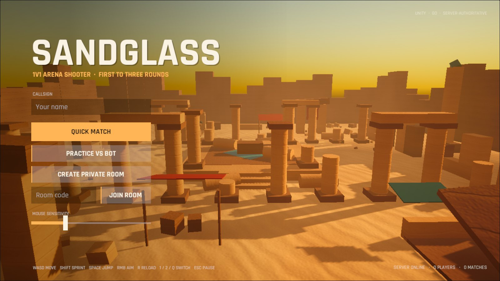
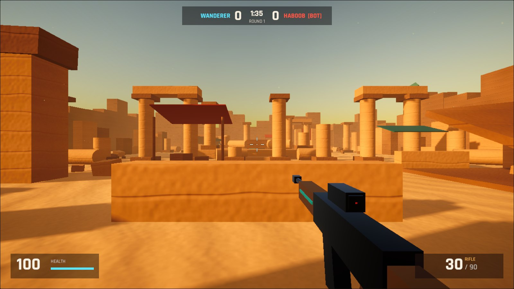
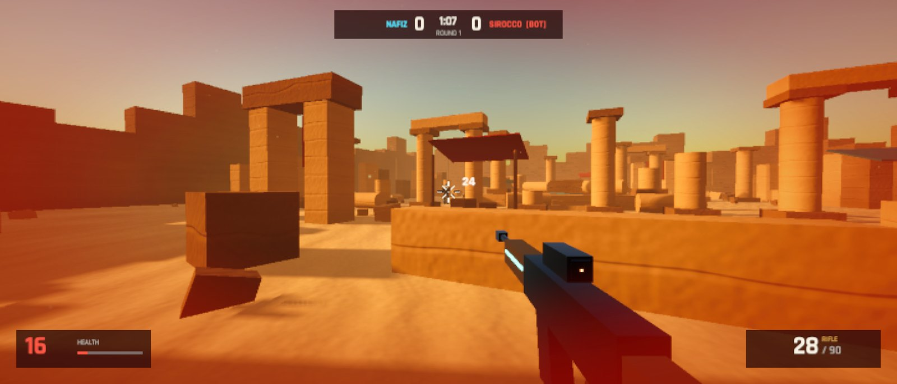
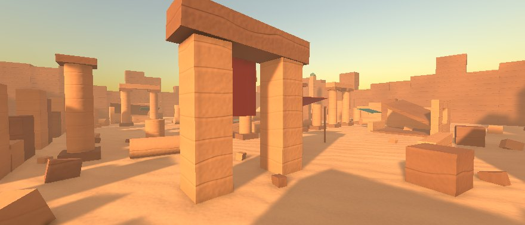

# Sandglass

A 1v1 arena shooter in desert ruins at golden hour. First to three rounds.

**Play in the browser at [sandglass.130-210-37-18.sslip.io](https://sandglass.130-210-37-18.sslip.io)**
(keyboard and mouse).
Quick match pairs you with whoever else is online, and a bot steps in if
nobody is. You can also practise against the bot straight away, or open a
private room and send the four-letter code to a friend.



The game is two programs. The **client** is Unity 6 (URP) built for WebGL.
The **match server** is a Go program that owns the match: it decides every
hit, every death and every round, and runs the bot. The client only draws
and predicts.

| | |
|---|---|
|  |  |
|  | |

## How a shot works

Players move on their own machines and send their position 30 times a
second. The server checks every move: no faster than a sprint, no
teleporting, and no standing inside a wall. A move that fails is
answered with a correction, and the client snaps back.

When you fire, the client draws the tracer and plays the sound straight
away, then sends the server the shot's origin, direction, weapon, and the
**server tick it was showing you**. The server then:

1. checks the rate of fire, the magazine, whether you are reloading, and
   that the shot starts within a metre of your eyes;
2. traces the ray against the arena's real colliders (exported from the
   Unity scene by `Assets/Editor/ArenaExporter.cs`) to see what stone it
   hits first;
3. **rewinds your opponent** to where they were at the tick you saw, up to
   300 ms back, and tests the ray against their head sphere and body
   capsule;
4. applies body or head damage, and broadcasts the shot to both players.

So a shot that was on target on your screen lands even with 100 ms of
ping, and a shot through a wall never does, whatever the client sends.

The opponent is drawn 100 ms in the past, interpolated between the 30 Hz
snapshots so their movement is smooth. Your ammo count is predicted
locally and corrected from snapshots once you stop firing.

## The bot

The bot lives on the server and plays by the same rules: it moves at a
capped speed, needs line of sight, and its shots go through the same
validation, so it cannot shoot through walls either. It finds its way
with A* over a 1 m walkability grid, which the server builds from the same
colliders at startup. A cell is walkable if a standing body fits there,
and the bot can climb only small steps, so it takes the temple stairs.
It hunts you, checks where it last saw you, reacts after about 0.45 s,
strafes during a fight, fires in bursts with about 2° of aim error, and
reloads when it is safe.

## The arena

The map is point-symmetric. The north half is the south half rotated
180° about the centre, so neither spawn has an advantage, and the low sun
comes from the west so neither player looks into it. The surfaces use a
hand-written URP shader (`Assets/Art/Shaders/SandglassTerrain.shader`)
that draws sandstone strata, wind ripples, grain and bump from world
position, so the big blocks never show stretched textures and the build
carries no texture files. Opponents are Quaternius's animated toon
characters, imported with glTFast: people play as the soldier and the bot
as the red-helmeted enemy, with aiming, running, flinching and dying
animations and the torso bent to where they aim. Every sound (gunshots,
hit markers, wind) is synthesised at startup.

## Running it

```console
$ cd server && go test ./... && go run ./cmd/sandglass   # match server on :7350
```

Open the project in Unity 6000.6, load `Assets/Scenes/Arena.unity` and
press Play. In the editor the client connects to `ws://127.0.0.1:7350/ws`.
A WebGL build connects to the deployed server unless the page has
`?server=ws://host:port/ws`.

**Sandglass → Build WebGL** writes `Builds/WebGL` with Brotli compression
(plus a `vercel.json` with the headers those files need, if you host it on
Vercel). **Sandglass → Export Arena For Server** rewrites
`server/internal/arena/arena.json` after the map changes.

Controls: WASD to move, Shift to sprint, Space to jump, right mouse to aim,
R to reload, 1, 2 or Q to switch weapons, Esc to pause.

## Server

| Endpoint | |
|---|---|
| `GET /ws` | the game, JSON over WebSocket |
| `GET /stats` | players online, matches, queue |
| `GET /healthz` | liveness |

`server/internal/geom` holds ray tests against oriented boxes, capsules
and spheres. `server/internal/arena` holds the map, line of sight and the
navigation grid. `server/internal/game` holds the match state machine,
weapons, lag compensation, the bot and the lobby. The tests cover walls
blocking shots, head and body damage, rate-of-fire and ammo limits,
spoofed shot origins, lag compensation inside and beyond its window,
rejected teleports and wall clipping, a full best-of-five, the bot
finding and killing an idle player, and private rooms.

The server runs as a small distroless image
(`ghcr.io/nafiz001/sandglass-server`) behind Caddy on an Oracle Cloud
Ampere instance. The same Caddy site serves the WebGL build, sending
Unity's Brotli files with `Content-Encoding: br`, so the page and the
WebSocket share one origin. CI runs `go vet` and race-enabled tests before building
the image for amd64 and arm64.

## Credits

Characters and guns from the [Toon Shooter Game Kit](https://quaternius.com/packs/toonshootergamekit.html)
by Quaternius (CC0). Rajdhani font by the Indian Type Foundry (SIL Open
Font License). The arena, shader, effects and sounds were made for this
project.
